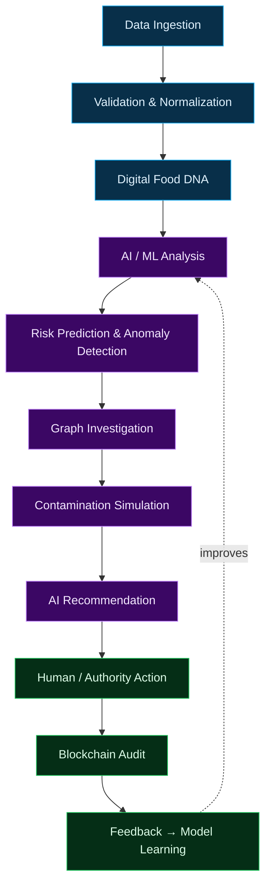
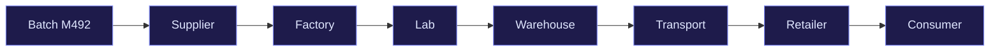
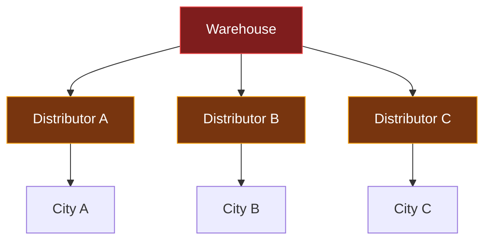
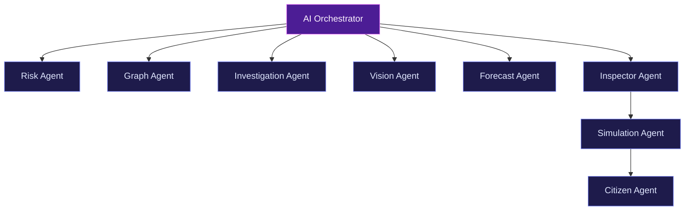
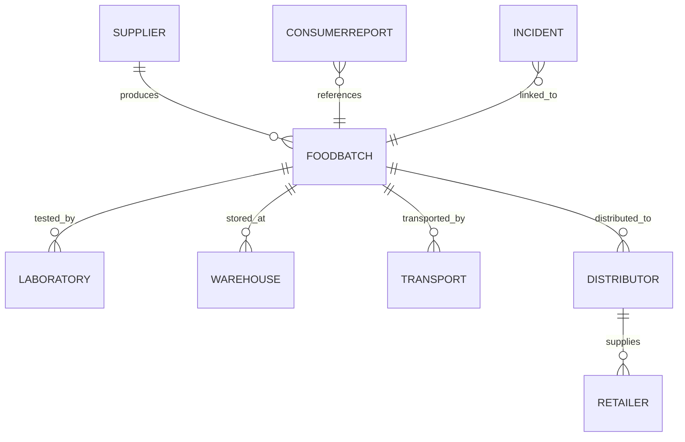
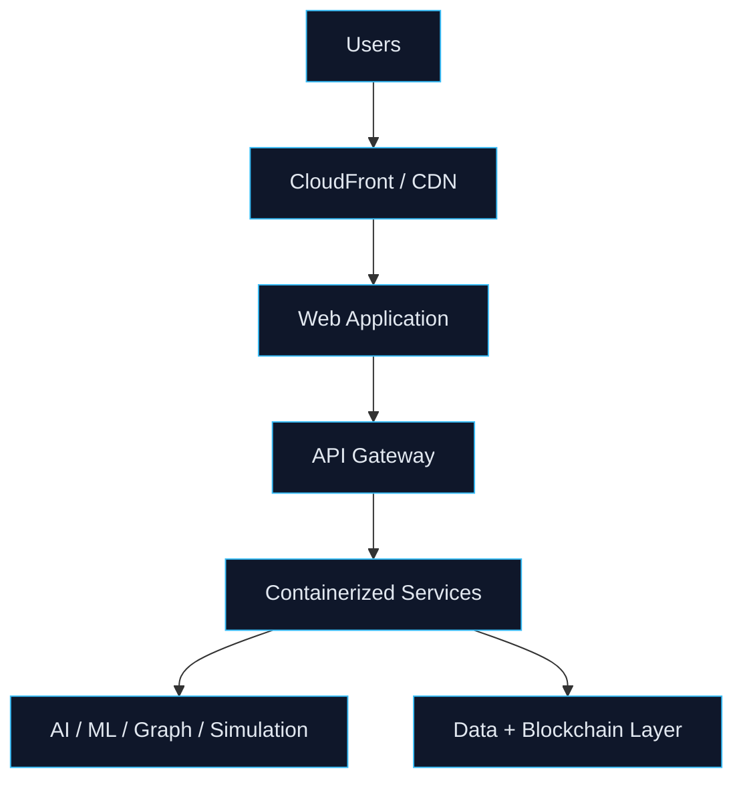

<div align="center">

  

  <h1>FOODGUARD X</h1>
  <p><em>An AI-powered digital twin of India's food-safety ecosystem</em></p>

  [](#)
  [](LICENSE)
  [](#)
  [](#)
  [](#)

</div>

# FOODGUARD X

## Predict → Prevent → Trace → Simulate → Act

[FOODGUARD X](#) is a national-scale food-safety intelligence platform for India. It predicts risk before it happens, traces every food batch from source to consumer, simulates how contamination could spread, and gives authorities a prioritized, explainable action plan — instead of waiting for a complaint to arrive after the fact.

---

## The Problem

Food safety today is reactive: a problem occurs, people get sick, a complaint is filed, then inspection and recall follow.


FOODGUARD X inverts this — signals are analyzed continuously so risk is caught before a crisis, not after:


---

## Key Features

### Predictive Intelligence
- **Digital Food DNA**: Every batch gets a unique, fully traceable identity from source to consumer
- **Food Safety Time Machine**: Projects how a batch's safety score could evolve over the next 12–72 hours
- **Unknown Risk Detector**: Surfaces statistically unusual patterns nobody wrote an explicit rule for

### Graph & Simulation Engine
- **Contamination Spread Simulator**: Models how a contaminated batch could travel through the supply chain
- **What-If Decision Engine**: Lets authorities simulate a recall or shutdown before acting on it
- **AI Food Crime-Scene Investigator**: Connects complaints, batches, warehouses, and sensor anomalies into an evidence chain

### Human-in-the-Loop AI
- **AI Inspector Copilot**: Ranks where inspectors should act first, with reasons attached
- **AI Vision Inspector**: Flags packaging damage, tampering, or storage issues from images — as a risk indicator, not a lab verdict
- **Citizen Food Safety Network**: Clusters scattered public reports into a single actionable lead

### Trust & Traceability
- **Blockchain Food Passport**: Tamper-evident audit trail for every key supply-chain event, on a permissioned Hyperledger Fabric ledger
- **Live India Risk Map**: Region-level risk with an explanation of *why*, not just a color
- **Self-Learning Loop**: Real incident outcomes continuously retrain and improve the models

---

## End-to-End Workflow



---

## System Architecture

```mermaid
flowchart TB
    subgraph L1["Data Sources"]
        A1[Suppliers · IoT · Labs · Warehouses · Transport · Weather · Citizens]
    end
    subgraph L2["Ingestion"]
        B1[API Gateway · AWS IoT · EventBridge · Streaming]
    end
    subgraph L3["Storage"]
        C1[S3 · Operational DB · Time-Series · Search · Data Lake]
    end
    subgraph L4["Intelligence Layer"]
        D1[ML · Computer Vision · Forecasting · Anomaly Detection · GNN · LLM Agents]
    end
    subgraph L5["Graph Intelligence"]
        E1[Neo4j / Amazon Neptune]
    end
    subgraph L6["AI Agent Layer"]
        F1[Orchestrator + 8 Specialized Agents]
    end
    subgraph L7["Blockchain"]
        G1[Hyperledger Fabric]
    end
    subgraph L8["Application Layer"]
        H1[Command Center · Inspectors · Labs · Businesses · Consumers]
    end

    L1 --> L2 --> L3 --> L4
    L4 --> L5 --> L6
    L6 --> L7
    L6 --> L8

    style L1 fill:#0c1e3e,stroke:#38bdf8
    style L2 fill:#0f2942,stroke:#0ea5e9
    style L3 fill:#1c1a3e,stroke:#818cf8
    style L4 fill:#2e1065,stroke:#c084fc
    style L5 fill:#3b1d0f,stroke:#fb923c
    style L6 fill:#4c1d95,stroke:#e879f9
    style L7 fill:#1a2e1a,stroke:#22c55e
    style L8 fill:#083344,stroke:#22d3ee
```



The **graph layer** models `Supplier → Batch → Factory → Warehouse → Transport → Distributor → Retailer → Consumer`, surfacing hidden multi-hop connections a flat database would miss. The **blockchain layer** is used selectively — batch identity, lab verification, inspections, audit history — not as a database for everything.

---

## Technology Stack

### Frontend
- **Next.js / React**: Command Center and consumer-facing UI
- **TypeScript + Tailwind CSS**: Type-safe, premium interface
- **Mapbox**: India-wide risk visualization

### Backend & AI
- **Python + FastAPI**: Core APIs and AI services
- **Amazon Bedrock**: LLM intelligence and agent orchestration
- **Amazon SageMaker**: Model training and deployment
- **TensorFlow + OpenCV**: Computer vision for packaging/food inspection
- **Neo4j / Amazon Neptune**: Supply-chain graph intelligence

### Data & Blockchain
- **Amazon S3**: Raw data, images, reports
- **PostgreSQL**: Application data
- **Amazon OpenSearch**: Search and investigation
- **Hyperledger Fabric**: Permissioned, tamper-evident audit ledger

### Infrastructure
- **AWS IoT + Amazon EventBridge**: Real-time sensor ingestion and event-driven architecture
- **AWS ECS/EKS + Lambda**: Containerized and serverless compute
- **Docker**: Consistent deployments
- **GitHub Actions**: CI/CD automation
- **Amazon CloudWatch**: Monitoring and observability

> This table reflects the target architecture. See `docs/architecture/` for what's actually implemented versus planned for production scale.

---

## Project Structure

```
foodguard-x/
├── apps/
│   ├── web/                     # National Command Center UI
│   ├── inspector/                # Inspector-facing application
│   └── consumer/                 # Consumer QR / passport app
├── services/
│   ├── api/                      # Core API gateway
│   ├── risk-engine/              # Risk scoring service
│   ├── graph-engine/             # Graph intelligence service
│   ├── vision-engine/            # Computer vision service
│   ├── forecast-engine/          # Time-series forecasting
│   └── simulation-engine/        # Contamination / what-if simulation
├── agents/
│   ├── orchestrator/
│   ├── risk-agent/
│   ├── graph-agent/
│   ├── investigation-agent/
│   ├── vision-agent/
│   └── inspector-agent/
├── blockchain/
│   └── hyperledger/               # Chaincode + network config
├── ml/
│   ├── training/
│   ├── inference/
│   └── evaluation/
├── data/
│   ├── schemas/
│   └── pipelines/
├── infrastructure/
│   ├── terraform/
│   ├── docker/
│   └── kubernetes/
├── docs/
│   ├── architecture/
│   └── api/
├── .gitignore
├── docker-compose.yml
└── README.md
```

---

## Installation & Setup

### Prerequisites
- **Node.js** (v18 or higher)
- **Python** (v3.10 or higher)
- **Docker**
- **Neo4j** (local or Aura)
- **AWS account** (for cloud services)

### 1. Clone the Repository
```bash
git clone https://github.com/<your-org>/foodguard-x.git
cd foodguard-x
```

### 2. Backend & API Setup
```bash
cd services/api
npm install
npm run dev
```

### 3. ML / AI Services Setup
```bash
cd ml
python -m venv venv
source venv/bin/activate
pip install -r requirements.txt
python main.py
```

### 4. Frontend Setup
```bash
cd apps/web
npm install
npm run dev
```

### 5. Full Stack (Docker)
```bash
docker-compose up --build
```

---

## Features in Detail

### Digital Food DNA
Every batch is assigned a unique traceable identity that follows it through the supply chain:



```
Current Safety Score:   84/100
Predicted (+24h):       62/100
Predicted (+48h):       31/100
```

### Contamination Spread Simulator
Models potential downstream exposure from a single point of contamination, and answers: *"Which single intervention could reduce the highest potential exposure?"*



### AI Inspector Copilot
Prioritizes inspection targets with explainable reasoning, so human attention goes where it matters most:

```
1. Warehouse #17     Risk 94/100   Cold-chain anomaly + downstream spread
2. Restaurant #42    Risk 87/100   Complaint cluster + supplier pattern
3. Batch #M492       Risk 82/100   Predicted safety degradation
```

### AI Agent Architecture


Nine agents, one orchestrator — each owns a single job (risk, graph, investigation, vision, forecast, inspection, simulation, citizen reports), coordinated centrally so recommendations stay consistent and explainable.

---

## Data Model



---

## API Design

```
POST /api/v1/batches                    GET  /api/v1/batches/{id}/risk
POST /api/v1/incidents                  GET  /api/v1/incidents/{id}/investigation
GET  /api/v1/risk/india                 GET  /api/v1/risk/region/{id}
POST /api/v1/simulation                 POST /api/v1/vision/analyze
POST /api/v1/lab/analyze                POST /api/v1/citizen/report
```

> Example routes — see `docs/api/` for endpoints actually implemented.

---

## Testing

```bash
# Backend / API tests
cd services/api
npm test

# ML model tests
cd ml
python -m pytest tests/

# Frontend tests
cd apps/web
npm test
```

**Test Coverage**
- Unit tests for all API endpoints
- Integration tests for end-to-end user workflows
- ML model accuracy and drift testing
- Simulation and graph-query correctness tests
- Security and access-control testing

---

## Continuous Integration

The project uses **GitHub Actions** for automated CI on every push and pull request targeting `main`.

| Workflow | Trigger | What it does |
|---|---|---|
| `api-ci.yml` | `push`/`pull_request` → `main` | `npm ci` → lint → `npm test` |
| `ml-ci.yml` | `push`/`pull_request` → `main` | `pip install` → lint → `pytest` |
| `deploy.yml` | `push` → `main` | Build & deploy to AWS |

---

## Security & Trust

- Role-based access control (RBAC) across every application layer
- Encryption at rest and in transit; rate-limited, authenticated APIs
- Permissioned blockchain — only verified participants can write records
- Full audit logs for sensitive actions
- **Human approval required for all high-impact actions** (recalls, shutdowns, public alerts)

### Privacy
- Citizen identity is never exposed in public-facing outputs
- Public dashboards show aggregated or anonymized data only
- Data minimization — only necessary information is collected

### Limitations & Responsible AI
- Predictions are probabilistic, not deterministic certainties
- Computer vision output is a risk indicator, not a laboratory test
- Simulation outputs are estimates, not guaranteed outcomes
- AI recommendations require human validation before action is taken
- Blockchain preserves what was recorded — it does not make false input data true

---

## Deployment



Built on event-driven, containerized services for elastic scaling, with AI/ML workloads decoupled from core transactional services — designed to scale from a single city to national deployment.

---

## Contributing

We welcome contributions from the community. Please read our Contributing Guidelines before getting started.

### Development Workflow
1. Fork the repository
2. Create a feature branch (`git checkout -b feature/amazing-feature`)
3. Commit your changes (`git commit -m 'Add amazing feature'`)
4. Push to the branch (`git push origin feature/amazing-feature`)
5. Open a Pull Request

### Code Standards
- Follow ESLint configuration for JavaScript/TypeScript
- Use Prettier for code formatting
- Write tests for new features
- Document all API changes
- Follow semantic versioning for releases

---

## Project Roadmap

### Phase 1 — MVP (Current)
- [x] Batch tracking and Digital Food DNA
- [x] Core risk scoring
- [x] Basic dashboard
- [x] Citizen reporting

### Phase 2 — Intelligence (In Progress)
- [ ] Graph intelligence and hidden-link detection
- [ ] Time-series forecasting
- [ ] Anomaly detection
- [ ] AI-assisted investigation

### Phase 3 — Advanced AI (Planned)
- [ ] Computer vision inspection
- [ ] Full agentic architecture
- [ ] Contamination spread simulation
- [ ] What-if decision engine

### Phase 4 — National Scale (Future)
- [ ] IoT sensor network integration
- [ ] Multi-state deployment
- [ ] Enterprise / institutional integrations
- [ ] Full-scale blockchain network
- [ ] Advanced MLOps and continuous learning at scale

---

## Support & Contact

**For general queries:** foodguardx.team@gmail.com

**For developers:** foodguardx.dev@outlook.com

---

## License

This project is licensed under the MIT License — see the [LICENSE](LICENSE) file for details.

<div align="center">

### FOODGUARD X
**Predict. Prevent. Trace. Simulate. Act.**

</div>
