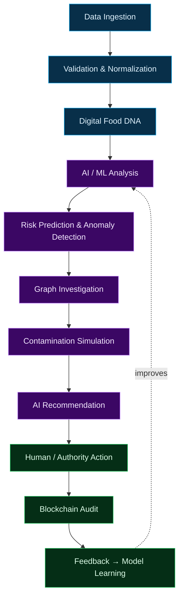
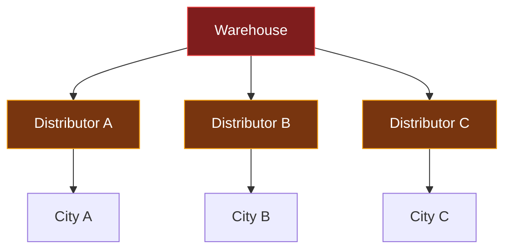
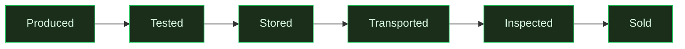
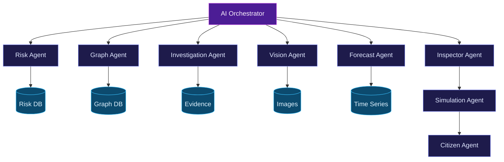
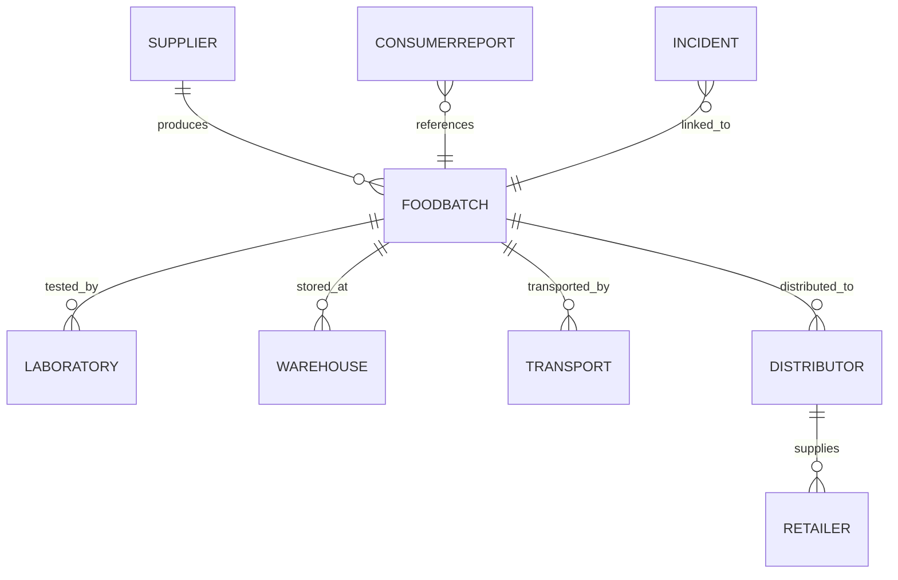
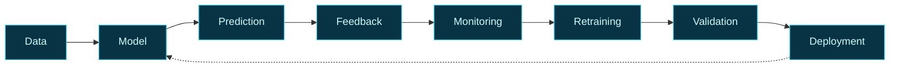
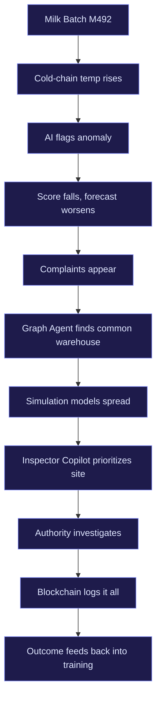

<div align="center">

# FOODGUARD X

### AI + ML + Graph Intelligence + Blockchain Food Safety Platform for India

**Predict → Prevent → Trace → Simulate → Act**

An AI-powered digital twin of India's food ecosystem — predicting risk before it happens, tracing every batch, simulating contamination spread, and giving authorities a prioritized action plan.

[](#)
[](#)
[](#)


</div>

---

## Table of Contents

1. [The Problem](#1-the-problem)
2. [Core Idea — Digital Twin](#2-core-idea--digital-twin)
3. [End-to-End Workflow](#3-end-to-end-workflow)
4. [System Architecture](#4-system-architecture)
5. [Technology Stack](#5-technology-stack)
6. [Digital Food DNA](#6-digital-food-dna)
7. [Predictive & Investigative Intelligence](#7-predictive--investigative-intelligence)
8. [AI Vision, Citizen Network & What-If Simulator](#8-ai-vision-citizen-network--what-if-simulator)
9. [Blockchain Food Passport](#9-blockchain-food-passport)
10. [Live India Risk Map & Consumer Experience](#10-live-india-risk-map--consumer-experience)
11. [AI Agent Architecture](#11-ai-agent-architecture)
12. [Data Model](#12-data-model)
13. [Security, Privacy & Responsible AI](#13-security-privacy--responsible-ai)
14. [Observability & MLOps](#14-observability--mlops)
15. [Project Structure](#15-project-structure)
16. [API Design](#16-api-design)
17. [Key User Journeys](#17-key-user-journeys)
18. [Why This Is Different](#18-why-this-is-different)
19. [Real-World Example](#19-real-world-example)
20. [Roadmap & Getting Started](#20-roadmap--getting-started)

---

## 1. The Problem

Food safety in India today is mostly **reactive**.


FOODGUARD X flips the model:


Traditional food safety asks *"Is this food unsafe?"* — FOODGUARD X asks:

> **"Where could a problem happen next, why, how could it spread, and what should we do before it becomes a crisis?"**

---

## 2. Core Idea — Digital Twin

FOODGUARD X builds a live digital twin of the food journey, enriched with environmental, regulatory, and human signals.


| Signal Type | Examples |
|---|---|
| Environmental | Weather, geography, flood/temperature data |
| Regulatory | Inspections, lab reports |
| Operational | Storage, humidity, transport logs |
| Human | Consumer & citizen complaints |
| Historical | Past incidents and recurring failures |

---

## 3. End-to-End Workflow



---

## 4. System Architecture


**Graph layer** models `Supplier → Batch → Factory → Warehouse → Transport → Distributor → Retailer → Consumer`, surfacing hidden multi-hop connections. **Blockchain** (permissioned, Hyperledger Fabric) is used selectively — batch identity, lab verification, inspections, audit history — not for general app data.

---

## 5. Technology Stack

<table>
<tr><th>Layer</th><th>Technology</th><th>Purpose</th></tr>
<tr><td>Frontend</td><td>  </td><td>Command Center UI</td></tr>
<tr><td>Maps</td><td></td><td>India risk visualization</td></tr>
<tr><td>Backend</td><td> </td><td>APIs & AI services</td></tr>
<tr><td>AI / ML</td><td>  </td><td>LLM agents, training, computer vision</td></tr>
<tr><td>Graph</td><td></td><td>Supply-chain intelligence</td></tr>
<tr><td>Blockchain</td><td></td><td>Tamper-evident audit trail</td></tr>
<tr><td>Storage</td><td>  </td><td>Raw data, app data, search</td></tr>
<tr><td>Events / IoT</td><td> </td><td>Real-time ingestion</td></tr>
<tr><td>Compute</td><td>  </td><td>Containers & serverless</td></tr>
<tr><td>Auth / Ops</td><td>Cognito ·  · </td><td>Identity, monitoring, CI/CD</td></tr>
</table>

> Table reflects the target architecture. See [`docs/architecture/`](./docs/architecture) for what's actually implemented vs. planned.

---

## 6. Digital Food DNA

Every batch gets a unique, traceable identity through its entire journey.


```text
Current Safety Score:   84/100
Predicted (+24h):       62/100
Predicted (+48h):       31/100
```

**Time Machine** — the same score is projected forward:


---

## 7. Predictive & Investigative Intelligence

**Contamination Spread Simulator** — models how a batch could travel through the network:



Answers: *"Which single intervention could reduce the highest potential exposure?"*

**Food Crime-Scene Investigator** — connects scattered signals into an evidence chain:

```text
23 Complaints → Same Product → Same Batch → Same Distributor → Same Warehouse → Possible Origin
```

Outputs a possible source, supporting evidence, confidence score, and a recommended investigation — **never** an automatic accusation.

**Unknown Risk Detector** — flags statistically unusual combinations (complaint clusters, abnormal temperature, unexpected graph links) that no fixed rule was written for:

```text
⚠ NEW FOOD SAFETY ANOMALY DETECTED
```

**Inspector Copilot** — prioritizes where human attention matters most:

```text
1. Warehouse #17     Risk 94/100   Cold-chain anomaly + downstream spread
2. Restaurant #42    Risk 87/100   Complaint cluster + supplier pattern
```

---

## 8. AI Vision, Citizen Network & What-If Simulator

| Feature | Input | Output |
|---|---|---|
| **AI Vision Inspector** | Food/packaging images, storage photos | Explainable flags — e.g. *"Seal geometry differs from expected pattern"* (a risk indicator, not a lab diagnosis) |
| **Citizen Network** | Photo, video, voice, location, QR | Clusters unrelated reports into a possible common batch/product |
| **What-If Simulator** | Scenario question (*"close this warehouse?"*) | Estimated affected batches, exposure reduction, and new disruptions — estimates, not guarantees |

---

## 9. Blockchain Food Passport



Each event becomes a tamper-evident record on **Hyperledger Fabric**. Blockchain preserves what was reported — it does not independently verify that the underlying data was true.

---

## 10. Live India Risk Map & Consumer Experience

```text
🟢 LOW   🟡 WATCH   🟠 HIGH   🔴 CRITICAL
```

Selecting a region always explains *why* — complaint spikes, cold-chain anomalies, weather, supply concentration, history.

**Consumer flow:**


---

## 11. AI Agent Architecture



Nine agents, one orchestrator — each owns one job (risk, graph, investigation, vision, forecast, inspection, simulation, citizen reports), coordinated centrally so recommendations stay consistent and explainable.

---

## 12. Data Model



---

## 13. Security, Privacy & Responsible AI

- RBAC, encryption at rest/in transit, rate-limited APIs, full audit logs
- Permissioned blockchain — only verified participants can write
- Citizen identity never exposed publicly; public data is aggregated/anonymized
- **Human approval required for all high-impact actions** (recalls, shutdowns, alerts)

**Limits, stated plainly:** predictions are probabilistic; computer vision is a risk indicator, not a lab test; simulations are estimates; citizen reports can contain false positives; AI recommendations always need human validation; blockchain can't make false input true; model quality depends on data quality.

---

## 14. Observability & MLOps



Model versioning, drift detection, prediction/API/infra monitoring, rollback, CI/CD, automated testing.

---

## 15. Project Structure

```text
foodguard-x/
├── apps/            # web (command center), inspector, consumer
├── services/        # api, risk-engine, graph-engine, vision-engine,
│                       forecast-engine, simulation-engine, investigation-engine
├── agents/          # orchestrator + 8 specialized agents
├── blockchain/      # Hyperledger Fabric chaincode & network config
├── ml/              # training, inference, evaluation, feature-engineering
├── data/            # schemas, pipelines, samples
├── infrastructure/  # terraform, docker, kubernetes
├── docs/            # architecture, api, decisions
└── README.md
```

---

## 16. API Design

```text
POST /api/v1/batches                          GET /api/v1/batches/{id}/risk
POST /api/v1/incidents                         GET /api/v1/incidents/{id}/investigation
GET  /api/v1/risk/india                        GET /api/v1/risk/region/{id}
POST /api/v1/simulation                        POST /api/v1/vision/analyze
POST /api/v1/lab/analyze                       POST /api/v1/citizen/report
```

> Example routes — see [`docs/api/`](./docs/api) for what's live.

---

## 17. Key User Journeys

<table>
<tr><th>Authority</th><th>Inspector</th><th>Business</th><th>Consumer</th></tr>
<tr valign="top">
<td>Login → Risk Map → Threat → Investigation → Graph → Simulation → Action</td>
<td>Copilot → Priorities → Site Visit → Vision Inspector → Evidence → Submit</td>
<td>Register Batch → Lab Report → Track DNA → Monitor Risk → Resolve</td>
<td>Scan QR → Food Passport → Safety Score → Why → Act</td>
</tr>
</table>

---

## 18. Why This Is Different

| Traditional | FOODGUARD X |
|---|---|
| Reactive | Predictive |
| Manual investigation | AI-assisted investigation |
| Static records | Connected food graph |
| Test after problem | Forecast before crisis |
| Basic traceability | Digital Food DNA |
| Simple recall | Contamination simulation |
| Historical data only | Continuous self-learning |

---

## 19. Real-World Example



A temperature sensor drifts out of range → the score drops and the forecast worsens → complaints trickle in → the graph reveals they all trace to one warehouse → a simulation estimates how far the batch may have spread → the warehouse becomes today's top inspection priority — all before it becomes a public health story.

---

## 20. Roadmap & Getting Started

| Phase | Focus |
|---|---|
| 1 — MVP | Batch tracking, Food DNA, risk scoring, dashboard, citizen reporting |
| 2 — Intelligence | Graph intelligence, forecasting, anomaly detection |
| 3 — Advanced AI | Vision, agents, contamination simulation, what-if engine |
| 4 — National Scale | IoT, multi-state deployment, enterprise integrations, full MLOps |

```bash
git clone https://github.com/<your-org>/foodguard-x.git
cd foodguard-x

# Backend
cd services/api && npm install && npm run dev

# ML services
cd ../../ml && python -m venv venv && source venv/bin/activate && pip install -r requirements.txt

# Frontend
cd ../apps/web && npm install && npm run dev

# Or run everything with Docker
docker-compose up --build
```

---

<div align="center">

## FOODGUARD X
### Predict. Prevent. Trace. Simulate. Act.
**A digital brain for India's food-safety ecosystem.**

</div>
