<div align="center">


# ⬡ FOODGUARD X

### The AI Digital Twin of India's Food Safety Ecosystem

<h3>Predict → Prevent → Trace → Simulate → Act</h3>

We don't wait for the first person to get sick. We find the warning signal first.

<br/>

[](#)
[](LICENSE)
[](#)

<br/>


</div>

<br/>

<table align="center">
<tr>
<td align="center" width="20%"><h3>9</h3><sub>AI AGENTS</sub></td>
<td align="center" width="20%"><h3>8</h3><sub>SUPPLY-CHAIN NODES</sub></td>
<td align="center" width="20%"><h3>72h</h3><sub>RISK FORECAST WINDOW</sub></td>
<td align="center" width="20%"><h3>1</h3><sub>NATIONAL DIGITAL TWIN</sub></td>
</tr>
</table>

<br/>

## Table of Contents

`01` [The Problem](#01--the-problem) · `02` [Core Idea](#02--core-idea--digital-twin) · `03` [Workflow](#03--end-to-end-workflow) · `04` [Architecture](#04--system-architecture) · `05` [Tech Stack](#05--technology-stack)

`06` [Digital Food DNA](#06--digital-food-dna--time-machine) · `07` [Simulation & Investigation](#07--simulation--investigation-engine) · `08` [Vision · Citizen · What-If](#08--vision-citizen-network--what-if-simulator) · `09` [Blockchain Passport](#09--blockchain-food-passport) · `10` [Risk Map & Consumer UX](#10--live-risk-map--consumer-experience)

`11` [AI Agent Architecture](#11--ai-agent-architecture) · `12` [Data Model](#12--data-model) · `13` [Security & Responsible AI](#13--security-privacy--responsible-ai) · `14` [Observability](#14--observability--mlops) · `15` [Project Structure](#15--project-structure)

`16` [API Design](#16--api-design) · `17` [User Journeys](#17--key-user-journeys) · `18` [Why It's Different](#18--why-this-is-different) · `19` [Real-World Walkthrough](#19--real-world-walkthrough) · `20` [Roadmap & Setup](#20--roadmap--getting-started)

<br/>

## 01 — The Problem

<table>
<tr>
<td width="50%" valign="top">

**Today — reactive by design**

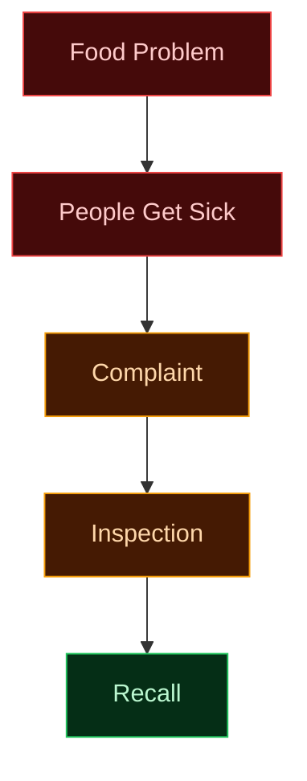

</td>
<td width="50%" valign="top">

**FOODGUARD X — predictive by design**

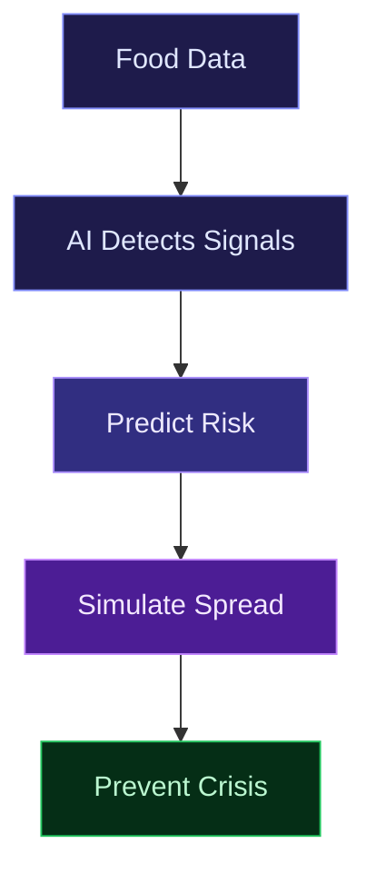

</td>
</tr>
</table>

> Traditional food safety asks **"Is this food unsafe?"**
> FOODGUARD X asks — **"Where could a problem happen next, why, how far could it spread, and what should we do before it's a crisis?"**

<br/>

## 02 — Core Idea · Digital Twin

A live, connected model of India's entire food journey — enriched with every signal around it.

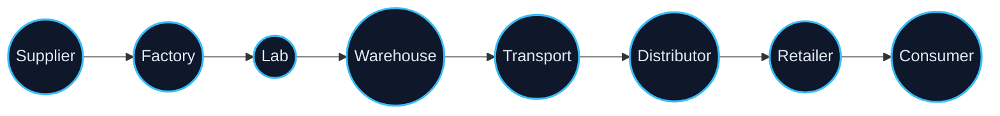

| Signal | Feeds |
|:--|:--|
| 🌦 Environmental | Weather, geography, flood & temperature data |
| 📋 Regulatory | Inspections, laboratory reports |
| 📦 Operational | Storage conditions, humidity, transport logs |
| 🗣 Human | Consumer & citizen complaints |
| 🕰 Historical | Past incidents, recurring failure patterns |

<br/>

## 03 — End-to-End Workflow


<br/>

## 04 — System Architecture

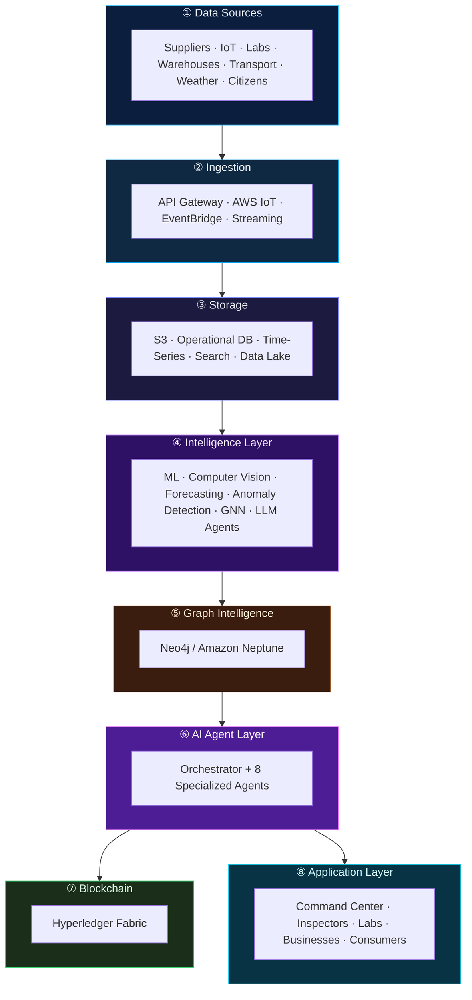

The **graph layer** models `Supplier → Batch → Factory → Warehouse → Transport → Distributor → Retailer → Consumer`, surfacing hidden multi-hop links a flat database would miss. **Blockchain** is used surgically — batch identity, lab verification, inspections, audit history — never as a database for everything.

<br/>

## 05 — Technology Stack

<table>
<tr><th>Layer</th><th>Stack</th><th>Purpose</th></tr>
<tr><td><b>Frontend</b></td><td>  </td><td>Command Center UI</td></tr>
<tr><td><b>Maps</b></td><td></td><td>India risk visualization</td></tr>
<tr><td><b>Backend</b></td><td> </td><td>APIs & AI services</td></tr>
<tr><td><b>AI / ML</b></td><td>  </td><td>LLM agents, training, vision</td></tr>
<tr><td><b>Graph</b></td><td></td><td>Supply-chain intelligence</td></tr>
<tr><td><b>Blockchain</b></td><td></td><td>Tamper-evident audit trail</td></tr>
<tr><td><b>Storage</b></td><td>  </td><td>Raw data, app data, search</td></tr>
<tr><td><b>Events / IoT</b></td><td> </td><td>Real-time ingestion</td></tr>
<tr><td><b>Compute</b></td><td>  </td><td>Containers & serverless</td></tr>
<tr><td><b>Auth / Ops</b></td><td>Cognito ·  · </td><td>Identity, monitoring, CI/CD</td></tr>
</table>

> Reflects target architecture — see `docs/architecture/` for implemented vs. planned.

<br/>

## 06 — Digital Food DNA & Time Machine

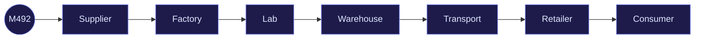

```
Current Safety Score:   84 / 100
Predicted (+24h):       62 / 100
Predicted (+48h):       31 / 100
```


<br/>

## 07 — Simulation & Investigation Engine

**Contamination Spread Simulator** — models how a batch could travel through the network:

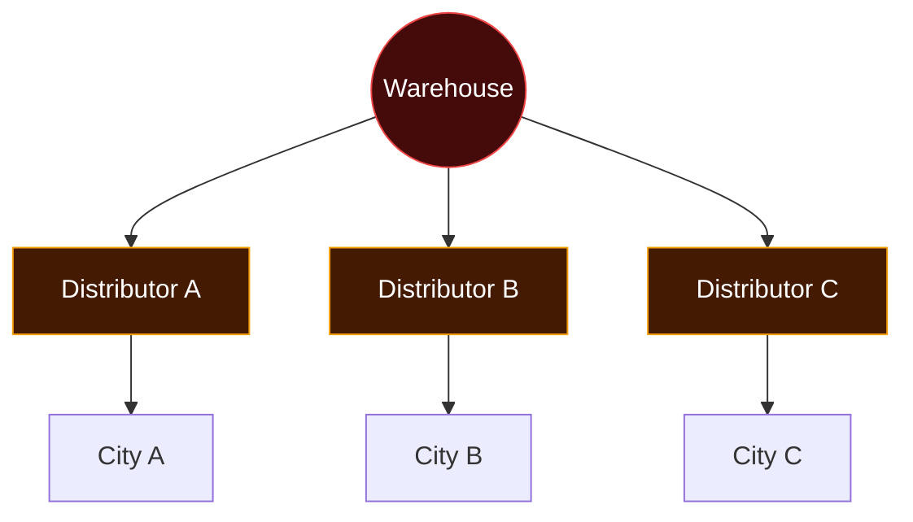

> **Core question it answers:** *"Which single intervention could reduce the highest potential exposure?"*

**Food Crime-Scene Investigator** — turns scattered complaints into an evidence chain:

```
23 Complaints → Same Product → Same Batch → Same Distributor → Same Warehouse → Possible Origin
```

**Unknown Risk Detector** — flags statistically unusual combinations no rule was ever written for:

```
⚠ NEW FOOD SAFETY ANOMALY DETECTED
```

**AI Inspector Copilot** — prioritizes where human attention matters most:

```
1. Warehouse #17     Risk 94/100   Cold-chain anomaly + downstream spread
2. Restaurant #42    Risk 87/100   Complaint cluster + supplier pattern
```

> None of this accuses anyone automatically — it generates evidence-based leads for human authorities.

<br/>

## 08 — Vision, Citizen Network & What-If Simulator

| Feature | Input | Output |
|:--|:--|:--|
| **AI Vision Inspector** | Food / packaging images, storage photos | Explainable flags — *"Seal geometry differs from expected pattern"* — a risk indicator, not a lab diagnosis |
| **Citizen Network** | Photo, video, voice, location, QR | Clusters unrelated reports into one possible common batch |
| **What-If Simulator** | *"Close this warehouse?"* | Estimated exposure reduction & new disruptions — estimates, not guarantees |

<br/>

## 09 — Blockchain Food Passport

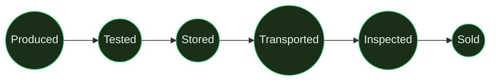

Every event becomes a tamper-evident record on **Hyperledger Fabric**. It preserves what was reported — it cannot make false input data true.

<br/>

## 10 — Live Risk Map & Consumer Experience

```
🟢 LOW      🟡 WATCH      🟠 HIGH      🔴 CRITICAL
```

Selecting a region always explains **why** — complaint spikes, cold-chain anomalies, weather, supply concentration, history.

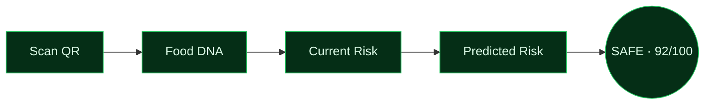

<br/>

## 11 — AI Agent Architecture

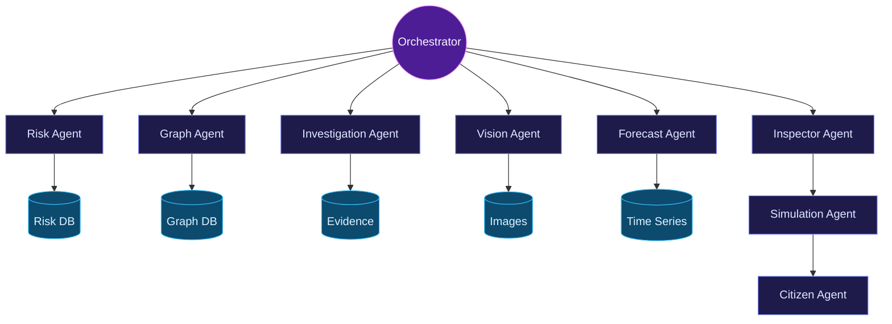

Nine agents, one orchestrator — each owns one job, coordinated centrally so recommendations stay consistent and explainable.

<br/>

## 12 — Data Model

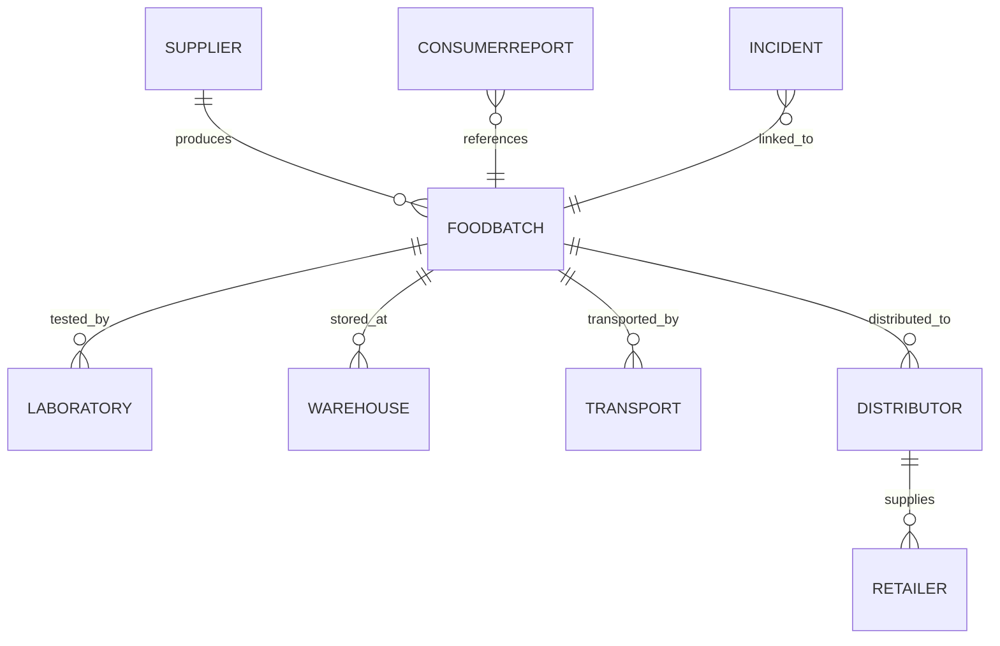

<br/>

## 13 — Security, Privacy & Responsible AI

- RBAC · encryption at rest/in transit · rate-limited, audited APIs
- Permissioned blockchain — only verified participants can write
- Citizen identity never exposed publicly; public data is aggregated/anonymized
- **Human approval required for every high-impact action** (recalls, shutdowns, alerts)

> Predictions are probabilistic. Vision output is a risk indicator, not a lab test. Simulations are estimates, not guarantees. AI recommendations always need human validation.

<br/>

## 14 — Observability & MLOps

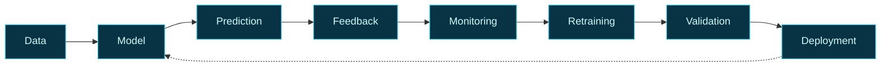

Model versioning · drift detection · prediction/API/infra monitoring · rollback · CI/CD · automated testing.

<br/>

## 15 — Project Structure

```
foodguard-x/
├── apps/            web · inspector · consumer
├── services/         api · risk-engine · graph-engine · vision-engine
│                     forecast-engine · simulation-engine · investigation-engine
├── agents/           orchestrator + 8 specialized agents
├── blockchain/       Hyperledger Fabric chaincode & network config
├── ml/               training · inference · evaluation · feature-engineering
├── data/             schemas · pipelines · samples
├── infrastructure/   terraform · docker · kubernetes
├── docs/             architecture · api · decisions
└── README.md
```

<br/>

## 16 — API Design

```
POST /api/v1/batches                 GET  /api/v1/batches/{id}/risk
POST /api/v1/incidents               GET  /api/v1/incidents/{id}/investigation
GET  /api/v1/risk/india              GET  /api/v1/risk/region/{id}
POST /api/v1/simulation              POST /api/v1/vision/analyze
POST /api/v1/lab/analyze             POST /api/v1/citizen/report
```

<br/>

## 17 — Key User Journeys

<table>
<tr><th>Authority</th><th>Inspector</th><th>Business</th><th>Consumer</th></tr>
<tr valign="top">
<td>Login → Risk Map → Threat → Investigation → Graph → Simulation → Action</td>
<td>Copilot → Priorities → Site Visit → Vision Inspector → Evidence → Submit</td>
<td>Register Batch → Lab Report → Track DNA → Monitor Risk → Resolve</td>
<td>Scan QR → Passport → Safety Score → Why → Act</td>
</tr>
</table>

<br/>

## 18 — Why This Is Different

| Traditional | FOODGUARD X |
|:--|:--|
| Reactive | Predictive |
| Manual investigation | AI-assisted investigation |
| Static records | Connected food graph |
| Test after the problem | Forecast before the crisis |
| Simple recall | Contamination simulation |
| Historical data only | Continuous self-learning |

<br/>

## 19 — Real-World Walkthrough

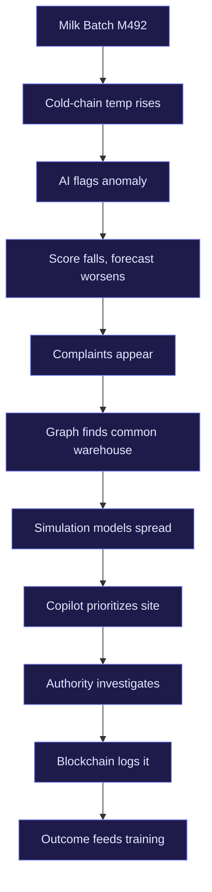

A sensor drifts out of range → score drops, forecast worsens → complaints trickle in → the graph traces them to one warehouse → simulation estimates the spread → the warehouse becomes today's top priority — all before it becomes a public health story.

<br/>

## 20 — Roadmap & Getting Started

| Phase | Focus |
|:--|:--|
| **1 · MVP** | Batch tracking, Food DNA, risk scoring, dashboard, citizen reporting |
| **2 · Intelligence** | Graph intelligence, forecasting, anomaly detection |
| **3 · Advanced AI** | Vision, agents, contamination simulation, what-if engine |
| **4 · National Scale** | IoT, multi-state deployment, enterprise integrations, full MLOps |

```bash
git clone https://github.com/<your-org>/foodguard-x.git && cd foodguard-x

cd services/api && npm install && npm run dev              # Backend
cd ../../ml && pip install -r requirements.txt && python main.py   # ML services
cd ../apps/web && npm install && npm run dev                # Frontend

docker-compose up --build                                    # Or full stack
```

---

<div align="center">


### FOODGUARD X
**Predict · Prevent · Trace · Simulate · Act**

*A digital brain for India's food-safety ecosystem.*

</div>
